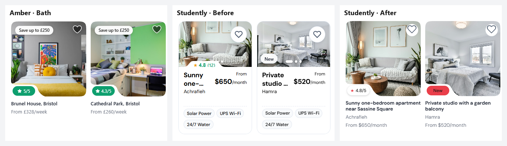
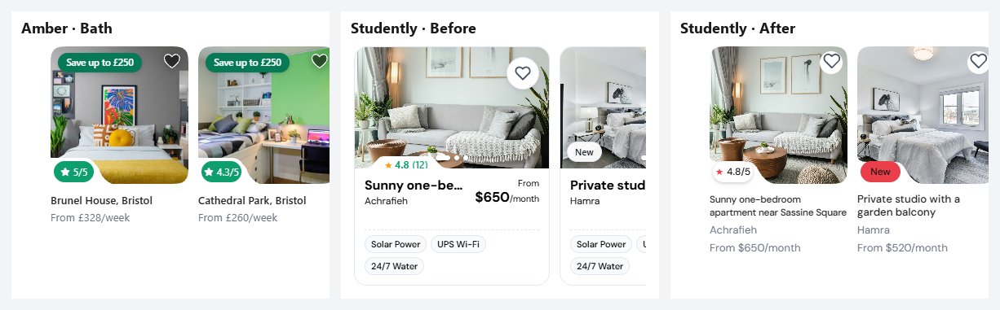
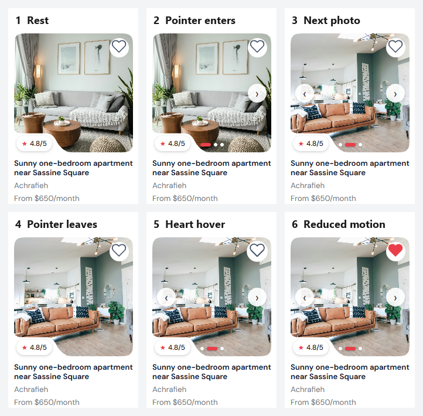

# Home property card review

The homepage now uses one shared property card and rail. The square photos, 26 px image corners in Chromium, 12 px card gap, 48 px rail inset, responsive widths, and two-card desktop scroll step follow Amber’s measured Bath row. Both web homepage routes use the component. [Plan](../PLAN.md) · [Amber measurements](../REFERENCE.md)

## Desktop · 1440 px

[Amber full row](../reference/amber-bath-1440.png) · [Studently before](studently-before-1440.png) · [Studently after](studently-after-1440.png)

## Mobile · 390 px touch viewport

[Amber full row](../reference/amber-bath-390.png) · [Studently before](studently-before-390.png) · [Studently after](studently-after-390.png)

[375 px comparison](comparison-375.png) · [430 px comparison](comparison-430.png)

Studently’s before and after captures use the homepage and listing components with a controlled local listing fixture and the same room photos for corresponding cards. The harness supplies listing and save responses, DM Sans font files, and lightweight stand-ins for the photo and icon rendering libraries. The 1440 and 390 baselines were captured before editing. The 375 and 430 baselines replay the archived pre-change rail code. The comparison images align the image tops. The full captures preserve the original gutter and rail placement.

## Hover and leave

The image and card frame stay stationary on hover and leave. The desktop photo controls appear immediately over the card and disappear on leave. Keyboard focus also reveals them. Advancing the photo uses Studently’s existing **220 ms ease** track transition. On direct heart hover, the existing favorite button scales to **1.05** with Amber’s **220 ms cubic-bezier(.22, 1, .36, 1)**. Its existing save pulse still plays on toggle. Reduced motion removes the scale and slide transitions. Touch keeps hover effects off and allows a photo swipe on the image and a row swipe from the card copy.

[Amber settled hover](../reference/amber-bath-hover-1440.png) · [Pointer enters](hover-02-enter.png) · [Photo advance](hover-03-next-photo.png) · [Pointer leaves](hover-04-leave.png) · [Direct heart hover](hover-05-heart.png)

## Studently adaptations

- The title uses DM Sans and has up to two lines, followed by area and monthly price. Titles that overflow at 13.179 px use a slightly smaller face within the same line height. A name that still exceeds the two lines remains available through the link’s accessible name and the title tooltip.
- Rating uses a white pill with a subtle shadow, a `#ea3f4a` star, and `#111` text. New uses a solid `#ea3f4a` pill. Both sit in a curved cutout in the photo’s lower-left corner, sized from Amber’s measured notch. Featured listings use the top-left pill. The home card has no amenity chips or border.
- Amber’s Bath cards have a single image and no photo controls. Studently keeps its carousel, with controls on desktop hover or keyboard focus and swipe on touch.
- The home query fetches up to 10 listings so the desktop rail can scroll when enough inventory is available. The end position follows the available cards. The fixture ends at 794 px at 1440, while Amber’s row includes additional trailing content and ends at 1021 px.

## Verification

- Browser checks covered **1440, 1280, 1024, 768, 430, 390 and 375 px**. Verified the 1:1 media, card widths and gap, 430 px desktop step and disabled boundaries, keyboard focus, reduced motion, touch photo and row swipes, title visibility, detail navigation, and shared favorite state. The search results card still renders its existing grid media and carousel presentation. [Before measurements](studently-before-measurements.json) · [After measurements](studently-after-measurements.json)
- The isolated commit candidate verified the white rating pill, red star, dark score, solid red New pill, and photo clipping along the bottom-left taper. The after screenshots and hover sequence were refreshed from that candidate.
- The initial home-card implementation passed the Expo production web export.
- TypeScript reported 39 existing diagnostics both on the parent revision and on the isolated commit candidate.
